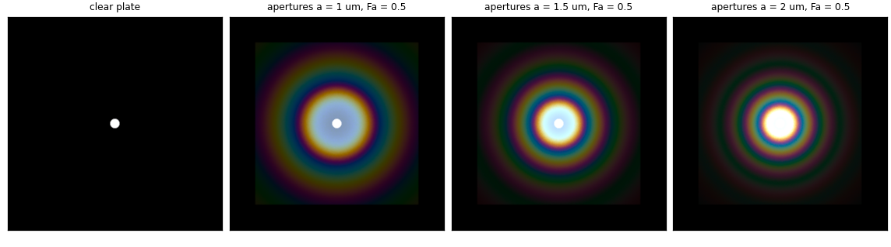
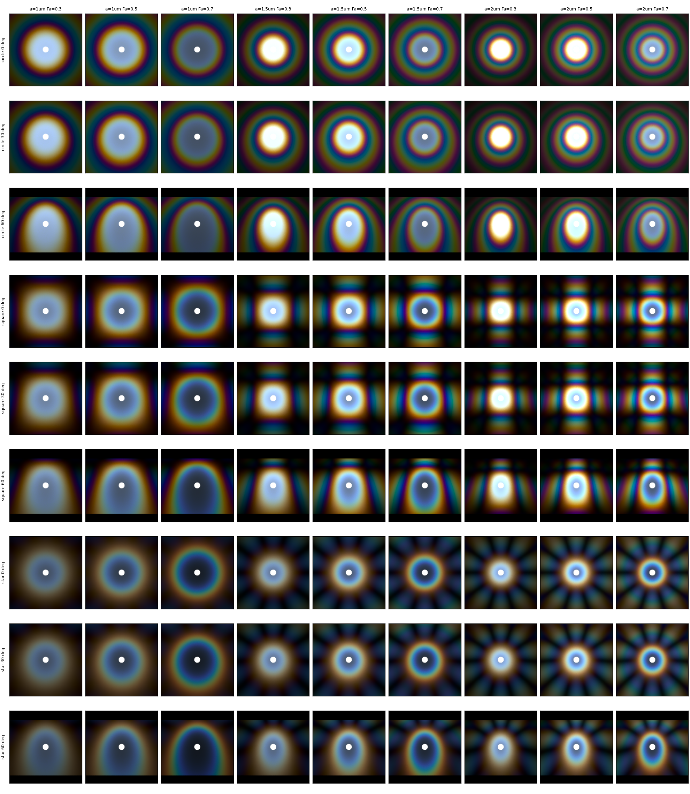
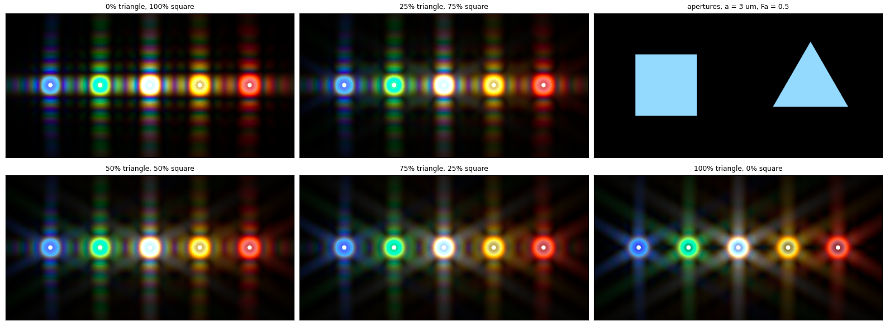
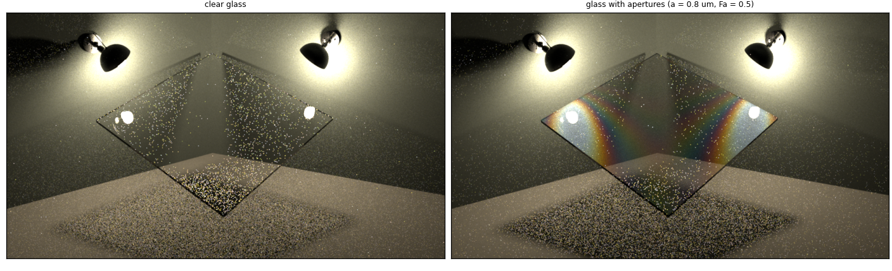
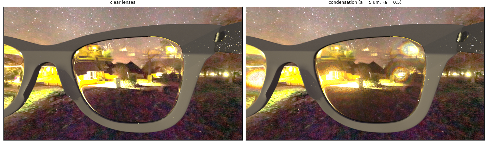

# A Wave-Optics BSDF for Correlated Scatterers

Ruomai Yang, Juhyeon Kim, Adithya Pediredla, Wojciech Jarosz
<br>Dartmouth College
<br>*Computer Graphics Forum (Proceedings of EGSR 2025)*, 44(4)
<br>[Paper (DOI 10.1111/cgf.70167)](https://doi.org/10.1111/cgf.70167)



Coloured rings (a *corona*) appear around a bright light seen through fabric,
or through glass covered in condensation. They come from diffraction by many
small, disordered but non-overlapping scatterers whose diffracted waves
interfere. This repository implements the paper's BSDF for such layers in
[Mitsuba 3](https://github.com/mitsuba-renderer/mitsuba3). The BSDF factors
into two parts:

* **`T_a`**: diffraction from a single aperture of any shape, precomputed
  once per shape with an FFT;
* **`S'`**: the structure factor of the hard-disk arrangement of the
  apertures (Percus–Yevick).

You can therefore change shape, size, area fraction and wavelength without
recomputing anything.

## Building

This is a fork of Mitsuba 3, and it is built the same way. Enable a
**spectral** variant: the effect depends on wavelength.

```bash
git clone --recursive <this repository>
cd <repository>
mkdir build && cd build
CC=clang CXX=clang++ cmake -G Ninja .. \
    -DMI_DEFAULT_VARIANTS="scalar_rgb;scalar_spectral;llvm_ad_spectral"
ninja
```

Notes:

* Tested with Clang 17 on Ubuntu. Dr.Jit rejects Clang 14, and GCC 12
  crashes with an internal compiler error on this Mitsuba version.
* Enable at least one `*_ad_*` variant. Otherwise the LLVM variants fail to
  load with `undefined symbol: jit_var_tan`, because this Mitsuba version
  links `drjit-extra` only when autodiff is enabled.
* With a recent CMake (≥ 4), add `-DCMAKE_POLICY_VERSION_MINIMUM=3.5`.
* The examples need `numpy`, `scipy` and `matplotlib`.

## Quick start

```bash
cd experiments
python quickstart.py            # ~10 s on a CPU, writes output/quickstart.png
```

Everything for the paper lives in `experiments/`:

```
experiments/
├── quickstart.py               minimal example, no assets needed
├── paper_fig*.py               one script per reproduced paper figure
├── wavebsdf.py                 texture generation + layer BSDF helper
├── common.py                   build lookup, image grids
├── assets/                     meshes and environment map for Figs. 1 and 12
├── figures/                    images shown in this README
└── output/                     renders and generated textures (not tracked)
```

`quickstart.py` renders the image above: a small light behind a clear plate, then
behind plates covered with circular apertures of increasing radius. Larger
apertures give smaller rings, and red rings are larger than blue ones. The
scripts look for Mitsuba in `<repo>/build/python`. Use `--build <dir>` or
`MI_BUILD=<dir>` for another build folder. If your `PYTHONPATH` points at a
different Mitsuba installation, clear it.

## Reproducing the paper figures

| Script | Paper | What it shows | CPU time* |
|---|---|---|---|
| [`paper_fig14_aperture_grid.py`](experiments/paper_fig14_aperture_grid.py) | Fig. 14 | back-lit plate: circle / square / star apertures × radius × area fraction × tilt | ~1 min |
| [`paper_fig10_shape_mixture.py`](experiments/paper_fig10_shape_mixture.py) | Fig. 10 | mixing triangular and square apertures (Eq. 28), five coloured lights | ~20 s |
| [`paper_fig12_glass_plate.py`](experiments/paper_fig12_glass_plate.py) | Fig. 12 | two lamps reflected and refracted by a glass plate with apertures | ~2 min |
| [`paper_fig01_sunglasses.py`](experiments/paper_fig01_sunglasses.py) | Fig. 1 | condensation on sunglasses at night | ~1 min |

\*`llvm_ad_spectral` on a 32-core CPU with the default sample counts.

| Fig. 14 | Fig. 10 |
|---|---|
|  |  |

| Fig. 12 | Fig. 1 |
|---|---|
|  |  |

Fig. 10 is simplified: the paper's lamp models are not included, so the
lights are small spheres. The white speckle in Fig. 12 is caustic noise from
the specular glass. It also appears with clear glass, and it fades with more
samples (`--spp`). The meshes and the environment map for Figs. 1 and 12 are in
[`experiments/assets/`](experiments/assets/).

## Using the BSDF in your own scenes

The Python helper [`experiments/wavebsdf.py`](experiments/wavebsdf.py) builds
the inputs and the complete layer BSDF:

```python
import mitsuba as mi
mi.set_variant('llvm_ad_spectral')
import wavebsdf as W

# Diffraction texture(s) for an aperture shape, tabulated once at radius a0
tex = W.make_texture_set('textures', 'star', {'star': 1.0}, a0=2.0)
# or a mixture of shapes, e.g. {'triangle': 0.25, 'square': 0.75}

bsdf = W.layer_bsdf(tex, Fa=0.5, a=1.5,         # area fraction, radius (um)
                    int_ior='bk7', ext_ior='air',
                    substrate=None)             # e.g. a diffuse dict for fabric
```

`layer_bsdf` combines three components with the weights of Eq. (20),
`w* : w_delta : w_o = F_r − F_r² : F_r² : 1 − F_r`:

- the diffraction lobe (`particle2d_IS_texture`);
- the specular (delta) part (`dielectric`);
- an optional substrate for light that misses the apertures.

The components are nested `blendbsdf`s.

### Plugin reference: `particle2d_IS_texture`

The plugin evaluates the diffraction component of Eq. (29):

```
f*(wi, wo, λ) = cos θi / cos θo · T_a(λ̂ q d) · S'(λ̂ q |d|) · (η λ̂ q)² / (1 − F_r)
d  = η (wo − wi')_xy          λ̂ = λ0 / λ,  λ0 = 350 nm
```

| Parameter | Type | Meaning |
|---|---|---|
| `Ia` | texture | aperture diffraction texture `T_a(d)` over `d ∈ (−2, 2)²` at λ0 (single-channel float EXR, load with `raw=true`) |
| `values` | string | structure factor `S'(d)` tabulated on `d ∈ [0, 2]` at λ0 (comma-separated) |
| `scale` | float | `q`: scales the tabulated system; effective radius = tabulation radius × `q` |
| `f` | float | real covered area fraction `F_r` |
| `int_ior`, `ext_ior` | float or string | indices of refraction on the two sides (Sec. 7.3) |
| `naive` | int | `1` (recommended): cosine-weighted sampling. `0`: experimental texture importance sampling (Sec. 7.2), not finished in this release |

The parameters `reflectance`, `sk`, `sk_I_seperate` and
`sample_sk_I_seperate` are left over from earlier versions and have no effect
in `naive = 1` mode.

## Changes relative to Mitsuba 3

This repository is based on Mitsuba 3 commit `d394bc40`. Mitsuba's
documentation and tutorials are not included; see the
[Mitsuba 3 repository](https://github.com/mitsuba-renderer/mitsuba3) for them.

New plugins:

* `src/bsdfs/particle2d_IS_texture.cpp`: the BSDF of the paper;
* `src/bsdfs/particle_importance_sampling.cpp`, `src/bsdfs/particle2d.cpp`:
  earlier prototypes, kept for reference.

Changes to Mitsuba itself:

* `BSDF::sample_more()` and `BSDF::eval_pdf_sample2()`
  (`include/mitsuba/render/bsdf.h`, `src/render/bsdf.cpp`, Python bindings):
  BSDF queries that take a second set of random numbers. By default they
  forward to `sample()` and `eval_pdf_sample()`.
* `src/integrators/path.cpp` passes the extra random numbers to
  `eval_pdf_sample2()`. Otherwise it behaves like upstream.
* `src/bsdfs/blendbsdf.cpp` adds an optional `newweight`: the probability of
  *sampling* `bsdf_1`, which defaults to 0.5 and is independent of `weight`.
  This keeps a lobe with a tiny blend weight from being starved of samples.
  Evaluation still returns `(1 − weight)·f0 + weight·f1`.
* `Texture::sample_position_column()` and related helpers in
  `distr_1d.h`/`distr_2d.h` (used by the experimental sampling code).

## Limitations

* The diffraction lobe is only reached through **emitter sampling**:
  `particle2d_IS_texture` returns zero weight from `sample()`. Coronas
  therefore appear around light sources and environment maps, which is what
  the paper shows. Light that is diffracted and then reflected by other
  surfaces before reaching an emitter is not captured.
* The paper's texture importance sampling (Sec. 7.2, Fig. 9) and spherical
  scatterers with Lorenz–Mie scattering (Secs. 6.2 and 7.4, Fig. 11) are not
  part of this release.
* Like the paper, rendering needs a spectral variant, and interference between
  the two sides of a glass plate is ignored.

## Citation

```bibtex
@article{yang2025waveoptics,
  title   = {A Wave-Optics {BSDF} for Correlated Scatterers},
  author  = {Yang, Ruomai and Kim, Juhyeon and Pediredla, Adithya and Jarosz, Wojciech},
  journal = {Computer Graphics Forum (Proceedings of EGSR)},
  volume  = {44},
  number  = {4},
  pages   = {e70167},
  year    = {2025},
  doi     = {10.1111/cgf.70167}
}
```

## License

The code is released under the same license as Mitsuba 3; see [LICENSE](LICENSE).
Mitsuba 3 is developed by the [Realistic Graphics Lab](https://rgl.epfl.ch) at
EPFL. If you use this code, please also cite
[Mitsuba 3](https://mitsuba-renderer.org).
